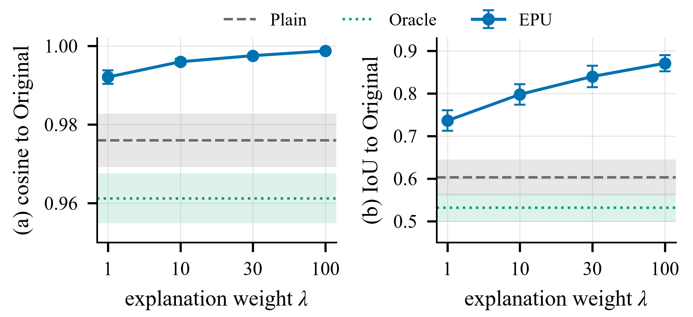

<p align="center">
  
</p>

<h1 align="center">Attention-Fidelity-Preserving Federated Unlearning</h1>
<p align="center"><b>Trustworthy Chest X-Ray Diagnosis with Vision Transformers</b></p>

<p align="center">
  
  
  
  
</p>

---

## Abstract

Federated learning lets hospitals co-train a shared chest X-ray diagnosis
model without ever exchanging patient images. Privacy regulation adds a second
obligation: when a hospital exercises its **right to be forgotten**, its
influence must be removed from the trained model — a process called
**federated unlearning**. Every existing unlearning method judges itself on
two axes only: did accuracy recover, and is the forgotten client's data
statistically undetectable. Neither axis checks *where the model is looking*.

This project introduces **Explanation-Preserving Unlearning (EPU)**: an
attention-consistency objective, `L = L_task + λ · L_exp`, that keeps a
model's attention-rollout explanation stable relative to the pre-unlearning
model while it forgets a client. The result is unlearning that is verified
not just on accuracy and forgetting, but on whether the model's reasoning —
the anatomical evidence it attends to — survives the procedure. In clinical
imaging, a model that predicts correctly while looking at the wrong region of
the scan is not trustworthy, no matter how clean its numbers are.

## Contents

- [Why this matters](#why-this-matters)
- [Method](#method)
- [Pipeline (M0 → M8)](#pipeline-m0--m8)
- [Measured results](#measured-results)
- [Repository structure](#repository-structure)
- [Setup](#setup)
- [Running the pipeline](#running-the-pipeline)
- [Interactive demo](#interactive-demo)
- [Reproducibility](#reproducibility)

## Why this matters

| | Restores accuracy | Erases statistical footprint | Preserves explanation |
|---|:---:|:---:|:---:|
| Retrain-from-scratch oracle | Yes | Yes | Gold standard, but computationally prohibitive |
| Prior federated unlearning methods | Yes | Yes | **Never checked** |
| **EPU (this work)** | Yes | Yes | **Measured & optimized for** |

A hospital-grade diagnostic model is not just a predictor — it is expected to
justify itself. EPU is, to our knowledge, the first federated unlearning
method that treats the model's explanation as a first-class quantity to
preserve, rather than a side effect to ignore.

## Method

<p align="center">
  
</p>

1. **Federated training** — FedAvg across non-IID, patient-disjoint clients
   produces the *Original* model and its per-round update history.
2. **Forgetting request** — one client withdraws; its influence must be removed.
3. **Unlearning methods (registry)** — `finetune_retain` (warm-started
   continued FedAvg on the remaining clients) and **EPU**, which adds the
   attention-consistency loss `L_exp` (MSE between the current model's
   attention-rollout map and the *frozen original* model's map, computed on
   remaining-client data — the forgotten client's data is never touched).
4. **Oracle** — full retrain from scratch, excluding the forgotten client, as
   the gold-standard reference for every axis below.
5. **Verification** — every configuration is scored on diagnostic performance,
   forgetting (forget-set loss, membership-inference AUC, prediction-distance
   to oracle), explanation similarity to the oracle, and wall-clock speedup.

## Pipeline (M0 → M8)

| Milestone | Scope | Status |
|---|---|:---:|
| M0 | Scaffolding, config system, logging, reproducibility utilities | Complete |
| M1 | Data pipeline — non-IID, patient-disjoint partitioning | Complete |
| M2 | Centralized ViT/DeiT baseline + multi-label metrics | Complete |
| M3 | Federated FedAvg simulation + per-round history capture | Complete |
| M4 | Federated unlearning + retrain oracle + forgetting verification | Complete |
| M5 | Explanation extraction (attention rollout) + explanation metrics | Complete |
| M6 | **EPU** — explanation-preserving unlearning | Complete |
| M7 | Multi-seed, multi-λ evaluation framework | Complete |
| M8 | Real NIH ChestX-ray14 integration + final experiment driver | Complete |

## Measured results

DeiT-Small@224, NIH ChestX-ray14, 5 clients (Dirichlet α = 0.5), client 0 forgotten,
3 seeds (42/43/44), mean ± sample s.d. on the held-out test split. Two fine-tuning
settings were run: **A** (2 rounds, step 2e-5) and **B** (5 rounds, step 1e-4).

| Model | Macro-AUROC | IoU of rollout maps with the Original | Membership-audit AUC | Speed-up vs. oracle |
|---|:---:|:---:|:---:|:---:|
| Original (before unlearning) | 0.805 ± 0.007 | 1 | 0.605 ± 0.042 | – |
| Oracle (retrained without client 0) | 0.802 ± 0.005 | 0.532 ± 0.033 | reference | 1× |
| **Setting A** | | | | |
| Plain fine-tuning | 0.806 ± 0.003 | 0.701 ± 0.017 | 0.570 ± 0.062 | 5.2× |
| EPU, λ = 0.5 | 0.806 ± 0.004 | 0.798 ± 0.012 | 0.553 ± 0.084 | 3.9× |
| EPU, λ = 1 | 0.806 ± 0.003 | **0.820 ± 0.011** | 0.555 ± 0.075 | 3.9× |
| **Setting B** | | | | |
| Plain fine-tuning | 0.789 ± 0.002 | 0.603 ± 0.042 | 0.539 ± 0.065 | 1.9× |
| EPU, λ = 1 | 0.789 ± 0.002 | 0.736 ± 0.024 | 0.546 ± 0.043 | 1.6× |
| EPU, λ = 10 | 0.787 ± 0.004 | 0.798 ± 0.024 | 0.535 ± 0.066 | 1.6× |
| EPU, λ = 30 | 0.788 ± 0.004 | 0.840 ± 0.025 | 0.531 ± 0.080 | 1.6× |
| EPU, λ = 100 | 0.787 ± 0.005 | **0.871 ± 0.019** | 0.549 ± 0.061 | 1.6× |
| **Gradient-ascent baseline (repair as in setting A)** | | | | |
| Ascent only | 0.766 ± 0.015 | 0.559 ± 0.130 | 0.439 ± 0.070 | – |
| GA (ascent + plain repair) | 0.806 ± 0.004 | 0.709 ± 0.038 | 0.547 ± 0.071 | – |
| GA + EPU, λ = 1 | 0.807 ± 0.003 | **0.817 ± 0.015** | 0.572 ± 0.073 | – |

The membership audit is the positive-finding attack calibrated by the Oracle's loss
(0.5 = chance), computed on the saved checkpoints; the plain loss-threshold attack is at
chance for every model, the Original included.

What the results show, stated as measured:

- **Explanation stability.** Fine-tuning moves the attention-rollout maps even where
  accuracy does not change. EPU keeps them closer to the pre-unlearning model in every
  seed and setting, at no cost in macro-AUROC relative to plain fine-tuning.
- **Not oracle fidelity.** EPU does not bring the maps reliably closer to those of the
  retrained Oracle; the Oracle's own maps differ from the Original's. The two notions are
  reported separately.
- **Forgetting.** The calibrated audit finds a weak trace of the forgotten client in the
  Original model. Fine-tuning lowers it without removing it, to the same extent with and
  without EPU. After gradient ascent, EPU retains slightly more of that trace than plain
  repair (0.572 against 0.547).
- **Utility.** Setting A keeps macro-AUROC; setting B loses about 1.7 points for Plain and
  EPU alike.
- **Limits.** One dataset, one backbone, five clients, one forgotten client, three seeds.

Result files:
[setting A](ec2_final_run/tfu/experiments/full_experiment/final_results.csv) ·
[setting B](ec2_final_run/tfu/experiments/exp_a1/final_results.csv) ·
[setting A stability](paper/setting_a_stability.csv) ·
[membership audit](paper/forgetting_attacks.csv) ·
[gradient-ascent baseline](paper/ga_results.csv).
`python paper/verify_numbers.py` checks the quoted numbers against these files.

<p align="center">
  
</p>

## Repository structure

```
Trustworthy-Federated-Unlearning/
├── configs/                  # default / data / model / federated / unlearn / eval YAML
├── src/
│   ├── utils/                 # seed, logging, config, reproducibility capture
│   ├── data/                  # synthetic + NIH loaders, patient-disjoint partitioning
│   ├── models/vit.py          # ViT / DeiT model factory
│   ├── federated/              # FedAvg client, server, strategy, history
│   ├── unlearning/             # oracle, method registry (finetune_retain, EPU, gradient ascent), verification
│   ├── explain/                # attention rollout (numpy + differentiable torch) + metrics
│   └── eval/                   # metrics, experiment runner, multi-seed/λ aggregation, figures
├── scripts/                   # one script per milestone (smoke_test.py … run_final.py),
│                               #   run_ga.py (gradient-ascent baseline), run_seed.py (staged extra seeds)
├── paper/                     # figure scripts, derived results and number checks behind the paper
├── tests/                     # unit + integration tests, one suite per milestone
├── docs/DATASET_NIH.md        # NIH ChestX-ray14 download & preparation guide
├── demo/                      # Streamlit dashboard — diagnosis, before/after, results
├── report/                    # architecture diagram + auto-generated report figures
├── ec2_final_run/             # curated final-run results (tables, figures, logs) —
│                               #   raw checkpoints/logs are intentionally not tracked (see below)
├── CN_Report_Federated_Unlearning.docx   # written project report (Review 1)
├── METRICS_AND_TERMS_EXPLAINED.md        # glossary of every metric used in the project
├── PROJECT_BRIEFING.md / HANDOFF.md      # project context & status handoff notes
└── requirements.txt · pyproject.toml · .gitignore
```

> **Note on `ec2_final_run/`:** the directory holds the outputs of the final
> AWS GPU training run. Only the lightweight, non-identifying artifacts —
> result tables, JSON summaries, figures, and run logs — are tracked. The
> multi-gigabyte model checkpoints (`*.pt`) and the raw dataset sample are
> excluded from version control (regenerate them with `scripts/run_final.py`
> against your own NIH download).

## Setup

```bash
pip install -r requirements.txt
```

The core stack is PyTorch + timm (+ scikit-learn for metrics), required from
**M2** onward. Where practical the code degrades gracefully so the scaffold
and tests still run without the full stack — the M0 smoke test uses a NumPy
forward-pass fallback, M1 loaders fall back to NumPy when torch is absent,
and M2 metrics fall back to a NumPy implementation when scikit-learn is
absent.

## Running the pipeline

```bash
python scripts/smoke_test.py       # M0 -> "M0 SMOKE TEST PASSED"
python scripts/prepare_data.py     # M1 -> "M1 DATA PIPELINE OK"
python scripts/train_central.py    # M2 -> "M2 CENTRAL BASELINE OK"   (needs torch+timm)
python scripts/eval.py             # M2 -> "M2 EVAL OK"
python scripts/run_federated.py    # M3 -> "M3 FEDERATED OK"          (needs torch+timm)
python scripts/run_unlearn.py      # M4 -> "M4 UNLEARN OK"            (uses M3 model)
python scripts/run_explain.py      # M5 -> "M5 EXPLAIN OK"            (uses M3/M4 models)
python scripts/run_epu.py          # M6 -> "M6 EPU OK"                (4-way comparison)
python scripts/run_evaluation.py   # M7 -> "M7 EVAL OK"               (multi-seed x multi-λ)
python scripts/run_final.py        # M8 -> full NIH run + tables + figures
python scripts/run_ga.py           # gradient-ascent baseline (reuses the Original/Oracle checkpoints)
pytest                              # all milestones
```

NIH ChestX-ray14 is not bundled (~42 GB, external license) — see
[`docs/DATASET_NIH.md`](docs/DATASET_NIH.md) for the download and folder
layout; the synthetic dataset in `configs/data.yaml` runs end-to-end without it.

## Interactive demo

A CPU-friendly Streamlit dashboard walks through diagnosis, before/after
unlearning, and the measured results table using the real trained
checkpoints — nothing simulated.

```bash
pip install -r demo/requirements-demo.txt
streamlit run demo/streamlit_app.py
```

See [`demo/README.md`](demo/README.md) for what it expects on disk.

## Reproducibility

Every final run captures its own environment (`reproducibility.json`):
Python/CUDA/package versions, device, git commit, seeds, and the exact
findings computed from that run's data — nothing hand-typed into a report.
Evaluation is fully separated from training
([`src/eval/experiment.py`](src/eval/experiment.py)): each seed retrains its
own chain independently, and results are aggregated (mean/std) into
`evaluation_results.csv`, `multi_seed_summary.csv`, `evaluation_tables.csv`,
and `ablation_lambda.csv`.
