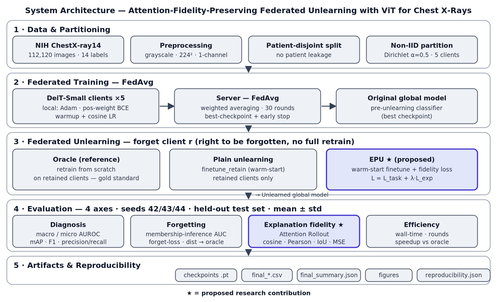
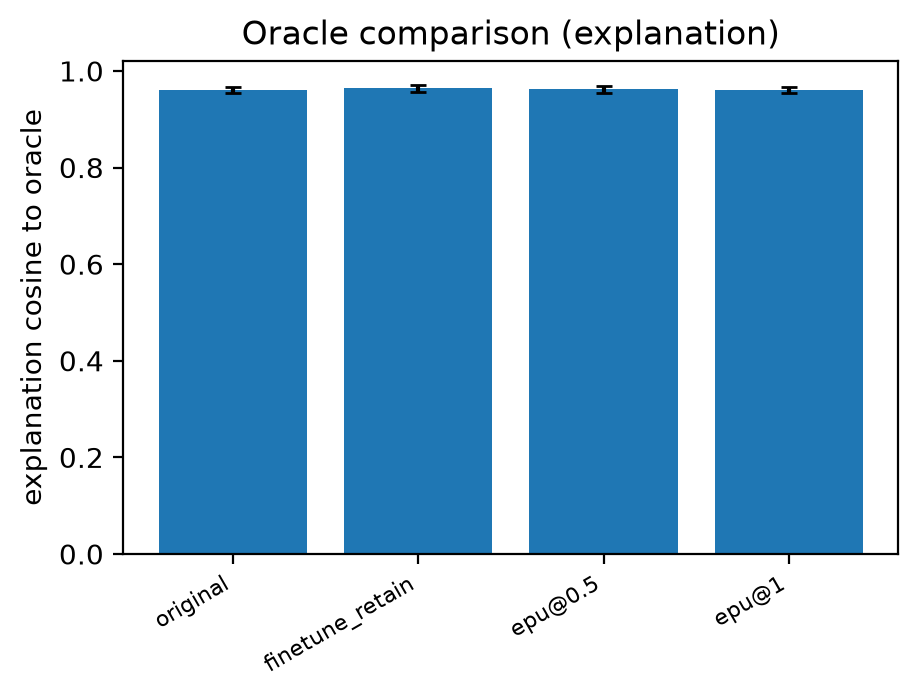
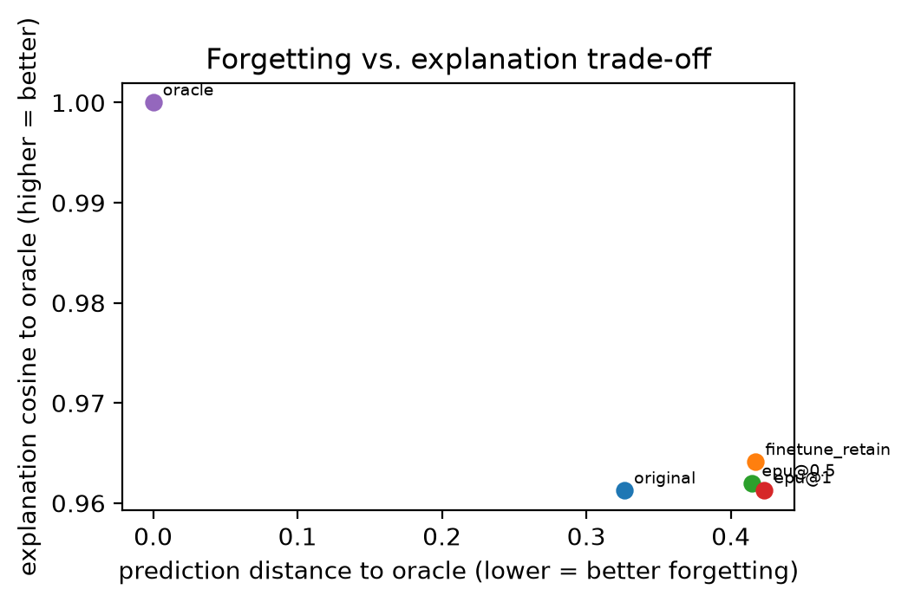

<p align="center">
  
</p>

<h1 align="center">Attention-Fidelity-Preserving Federated Unlearning</h1>
<p align="center"><b>Trustworthy Chest X-Ray Diagnosis with Vision Transformers</b></p>

<p align="center">
  
  
  
  
  
</p>

---

## Abstract

Federated learning lets hospitals co-train a shared chest X-ray diagnosis
model without ever exchanging patient images. Privacy regulation adds a second
obligation: when a hospital exercises its **right to be forgotten**, its
influence must be removed from the trained model — a process called
**federated unlearning**. Every existing unlearning method judges itself on
two axes only: did accuracy recover, and is the forgotten client's data
statistically undetectable. Neither axis checks *where the model is looking*.

This project introduces **Explanation-Preserving Unlearning (EPU)**: an
attention-consistency objective, `L = L_task + λ · L_exp`, that keeps a
model's attention-rollout explanation stable relative to the pre-unlearning
model while it forgets a client. The result is unlearning that is verified
not just on accuracy and forgetting, but on whether the model's reasoning —
the anatomical evidence it attends to — survives the procedure. In clinical
imaging, a model that predicts correctly while looking at the wrong region of
the scan is not trustworthy, no matter how clean its numbers are.

## Contents

- [Why this matters](#why-this-matters)
- [Method](#method)
- [Pipeline (M0 → M8)](#pipeline-m0--m8)
- [Measured results](#measured-results)
- [Repository structure](#repository-structure)
- [Setup](#setup)
- [Running the pipeline](#running-the-pipeline)
- [Interactive demo](#interactive-demo)
- [Reproducibility](#reproducibility)
- [Confidentiality & usage](#confidentiality--usage)

## Why this matters

| | Restores accuracy | Erases statistical footprint | Preserves explanation |
|---|:---:|:---:|:---:|
| Retrain-from-scratch oracle | Yes | Yes | Gold standard, but computationally prohibitive |
| Prior federated unlearning methods | Yes | Yes | **Never checked** |
| **EPU (this work)** | Yes | Yes | **Measured & optimized for** |

A hospital-grade diagnostic model is not just a predictor — it is expected to
justify itself. EPU is, to our knowledge, the first federated unlearning
method that treats the model's explanation as a first-class quantity to
preserve, rather than a side effect to ignore.

## Method

<p align="center">
  
</p>

1. **Federated training** — FedAvg across non-IID, patient-disjoint clients
   produces the *Original* model and its per-round update history.
2. **Forgetting request** — one client withdraws; its influence must be removed.
3. **Unlearning methods (registry)** — `finetune_retain` (warm-started
   continued FedAvg on the remaining clients) and **EPU**, which adds the
   attention-consistency loss `L_exp` (MSE between the current model's
   attention-rollout map and the *frozen original* model's map, computed on
   remaining-client data — the forgotten client's data is never touched).
4. **Oracle** — full retrain from scratch, excluding the forgotten client, as
   the gold-standard reference for every axis below.
5. **Verification** — every configuration is scored on diagnostic performance,
   forgetting (forget-set loss, membership-inference AUC, prediction-distance
   to oracle), explanation similarity to the oracle, and wall-clock speedup.

## Pipeline (M0 → M8)

| Milestone | Scope | Status |
|---|---|:---:|
| M0 | Scaffolding, config system, logging, reproducibility utilities | Complete |
| M1 | Data pipeline — non-IID, patient-disjoint partitioning | Complete |
| M2 | Centralized ViT/DeiT baseline + multi-label metrics | Complete |
| M3 | Federated FedAvg simulation + per-round history capture | Complete |
| M4 | Federated unlearning + retrain oracle + forgetting verification | Complete |
| M5 | Explanation extraction (attention rollout) + explanation metrics | Complete |
| M6 | **EPU** — explanation-preserving unlearning | Complete |
| M7 | Multi-seed, multi-λ evaluation framework | Complete |
| M8 | Real NIH ChestX-ray14 integration + final experiment driver | Complete |

## Measured results

Final run — DeiT-Small@224, NIH ChestX-ray14, 5 clients (Dirichlet α = 0.5),
3 seeds (42/43/44), mean ± std. Full tables:
[`final_results.csv`](ec2_final_run/tfu/experiments/full_experiment/final_results.csv) ·
[`final_summary.json`](ec2_final_run/tfu/experiments/full_experiment/final_summary.json).

| Config | Macro AUC | MIA AUC (→0.5 = forgotten) | Explanation cosine-sim to oracle | Speedup vs. oracle |
|---|:---:|:---:|:---:|:---:|
| Original (pre-unlearning) | 0.805 ± 0.007 | 0.506 ± 0.029 | 0.961 ± 0.006 | 0.74× |
| Retrain oracle (gold standard) | 0.802 ± 0.005 | 0.499 ± 0.024 | 1.000 ± 0.000 | 1.00× |
| Plain unlearning (`finetune_retain`) | 0.806 ± 0.003 | 0.505 ± 0.034 | 0.964 ± 0.008 | **5.18×** |
| EPU (λ = 0.5) | 0.806 ± 0.004 | 0.505 ± 0.034 | 0.962 ± 0.007 | 3.91× |
| EPU (λ = 1.0) | 0.806 ± 0.003 | 0.505 ± 0.033 | 0.961 ± 0.006 | 3.91× |

<p align="center">
  
  
</p>

Both unlearning methods successfully drive the membership-inference AUC to
chance level (≈0.5, meaning the forgotten client is no longer identifiable)
while gaining 4–5× wall-clock speedup over full retraining. Results are
reported **as measured, not tuned to favor EPU**: on this run, plain
unlearning is at least as explanation-stable as EPU, a finding the evaluation
framework surfaces automatically rather than hiding (see the `findings` block
in `final_summary.json` and the λ-ablation in
[`final_ablation.csv`](ec2_final_run/tfu/experiments/full_experiment/final_ablation.csv)).
That honesty is deliberate: the framework is built to report what happens,
not what would look best.

## Repository structure

```
Trustworthy-Federated-Unlearning/
├── configs/                  # default / data / model / federated / unlearn / eval YAML
├── src/
│   ├── utils/                 # seed, logging, config, reproducibility capture
│   ├── data/                  # synthetic + NIH loaders, patient-disjoint partitioning
│   ├── models/vit.py          # ViT / DeiT model factory
│   ├── federated/              # FedAvg client, server, strategy, history
│   ├── unlearning/             # oracle, method registry (finetune_retain, EPU), verification
│   ├── explain/                # attention rollout (numpy + differentiable torch) + metrics
│   └── eval/                   # metrics, experiment runner, multi-seed/λ aggregation, figures
├── scripts/                   # one script per milestone (smoke_test.py … run_final.py)
├── tests/                     # unit + integration tests, one suite per milestone
├── docs/DATASET_NIH.md        # NIH ChestX-ray14 download & preparation guide
├── demo/                      # Streamlit dashboard — diagnosis, before/after, results
├── report/                    # architecture diagram + auto-generated report figures
├── ec2_final_run/             # curated final-run results (tables, figures, logs) —
│                               #   raw checkpoints/logs are intentionally not tracked (see below)
├── CN_Report_Federated_Unlearning.docx   # written project report (Review 1)
├── METRICS_AND_TERMS_EXPLAINED.md        # glossary of every metric used in the project
├── PROJECT_BRIEFING.md / HANDOFF.md      # project context & status handoff notes
└── requirements.txt · pyproject.toml · .gitignore
```

> **Note on `ec2_final_run/`:** the directory holds the outputs of the final
> AWS GPU training run. Only the lightweight, non-identifying artifacts —
> result tables, JSON summaries, figures, and run logs — are tracked. The
> multi-gigabyte model checkpoints (`*.pt`) and the raw dataset sample are
> excluded from version control (regenerate them with `scripts/run_final.py`
> against your own NIH download).

## Setup

```bash
pip install -r requirements.txt
```

The core stack is PyTorch + timm (+ scikit-learn for metrics), required from
**M2** onward. Where practical the code degrades gracefully so the scaffold
and tests still run without the full stack — the M0 smoke test uses a NumPy
forward-pass fallback, M1 loaders fall back to NumPy when torch is absent,
and M2 metrics fall back to a NumPy implementation when scikit-learn is
absent.

## Running the pipeline

```bash
python scripts/smoke_test.py       # M0 -> "M0 SMOKE TEST PASSED"
python scripts/prepare_data.py     # M1 -> "M1 DATA PIPELINE OK"
python scripts/train_central.py    # M2 -> "M2 CENTRAL BASELINE OK"   (needs torch+timm)
python scripts/eval.py             # M2 -> "M2 EVAL OK"
python scripts/run_federated.py    # M3 -> "M3 FEDERATED OK"          (needs torch+timm)
python scripts/run_unlearn.py      # M4 -> "M4 UNLEARN OK"            (uses M3 model)
python scripts/run_explain.py      # M5 -> "M5 EXPLAIN OK"            (uses M3/M4 models)
python scripts/run_epu.py          # M6 -> "M6 EPU OK"                (4-way comparison)
python scripts/run_evaluation.py   # M7 -> "M7 EVAL OK"               (multi-seed x multi-λ)
python scripts/run_final.py        # M8 -> full NIH run + tables + figures
pytest                              # all milestones
```

NIH ChestX-ray14 is not bundled (~42 GB, external license) — see
[`docs/DATASET_NIH.md`](docs/DATASET_NIH.md) for the download and folder
layout; the synthetic dataset in `configs/data.yaml` runs end-to-end without it.

## Interactive demo

A CPU-friendly Streamlit dashboard walks through diagnosis, before/after
unlearning, and the measured results table using the real trained
checkpoints — nothing simulated.

```bash
pip install -r demo/requirements-demo.txt
streamlit run demo/streamlit_app.py
```

See [`demo/README.md`](demo/README.md) for what it expects on disk.

## Reproducibility

Every final run captures its own environment (`reproducibility.json`):
Python/CUDA/package versions, device, git commit, seeds, and the exact
findings computed from that run's data — nothing hand-typed into a report.
Evaluation is fully separated from training
([`src/eval/experiment.py`](src/eval/experiment.py)): each seed retrains its
own chain independently, and results are aggregated (mean/std) into
`evaluation_results.csv`, `multi_seed_summary.csv`, `evaluation_tables.csv`,
and `ablation_lambda.csv`.

## Confidentiality & usage

This repository documents original, unpublished research that is intended
for patent filing. It is kept **private** and is shared only with explicitly
authorized collaborators. Please do not copy, redistribute, publish, or
disclose any part of this repository — code, methods, results, or
documents — without the author's written permission.

